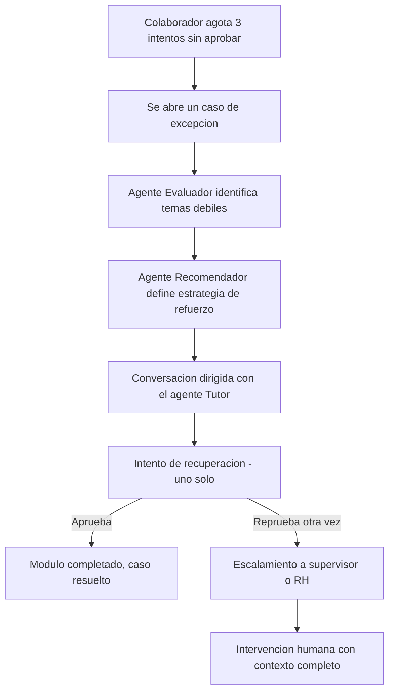

# PRD — Plataforma de Onboarding Interactivo Guiado por Agentes Inteligentes

**Empresa:** [Nombre de la empresa]
**Documento:** Product Requirements Document
**Versión:** 1.0 · Septiembre 2026
**Documentos relacionados:** `Documento_Arquitectura_Onboarding.docx` (cómo se construye) · `Definicion_MVP_Onboarding.docx` (qué entra en la v1) · `schema.sql` (modelo de datos completo)

---

## 1. Resumen ejecutivo

La empresa necesita automatizar y personalizar el proceso de incorporación de nuevos colaboradores. Hoy ese proceso es manual: instrucciones dispersas por correo, checklists en hojas de cálculo, y seguimiento que depende de que alguien de RH se acuerde de preguntar.

La plataforma resuelve esto con una capa de agentes inteligentes que guían al colaborador de punta a punta — documentos, capacitación, dudas y seguimiento — mientras RH y los supervisores mantienen visibilidad y control sin tener que operar cada paso manualmente.

**Principio de producto:** el sistema debe poder resolver un problema por sí mismo antes de escalarlo a una persona. La intervención humana es el último recurso, no el primero — esto se refleja en cómo está diseñado el manejo de cuestionarios reprobados (sección 6.4).

---

## 2. Problema y justificación

| | |
|---|---|
| **Impacto en la industria** | Digitaliza y estandariza la incorporación del talento — hoy es un proceso ad hoc que varía según quién lo ejecute. |
| **Valor para la empresa** | Consolida una solución HRTech propia, enfocada al ciclo de vida del colaborador, en vez de depender de procesos manuales o herramientas genéricas. |
| **Costo de no resolverlo** | Onboarding lento y desigual, RH saturada respondiendo las mismas preguntas repetidas, y ningún dato consolidado sobre dónde se atoran los colaboradores nuevos. |

---

## 3. Usuarios y roles

El sistema tiene tres roles operativos. **No están escritos como reglas fijas del sistema** — son datos: un catálogo de roles y uno de permisos, conectados por una tabla intermedia (`roles`, `permissions`, `role_permissions` en el esquema). Si la empresa reorganiza esta función más adelante, se ajustan permisos con datos, no con una migración de base de datos.

### 3.1 Colaborador nuevo
La persona que se está incorporando. Su objetivo es completar su onboarding con el menor fricción posible.

- Iniciar sesión (SSO) y consultar su perfil.
- Ver su roadmap de onboarding con checklist de documentos y capacitación.
- Subir documentos requeridos.
- Consultar módulos de capacitación, leer el contenido y marcarlos como completados.
- Contestar el cuestionario al final de cada módulo (hasta 3 intentos regulares + 1 de recuperación si aplica).
- Conversar con los agentes (orquestador, documentos, tutor, preguntas/FAQ, seguimiento).
- Consultar su porcentaje de avance.

### 3.2 Administrador de RH
Gestiona el proceso de onboarding a nivel empresa.

- Registrar colaboradores y asignarles una plantilla de onboarding.
- Editar, activar y desactivar usuarios.
- Crear y editar módulos, documentos requeridos y material de capacitación (diapositivas, PDF, imágenes).
- Validar o rechazar documentos subidos, con motivo de rechazo.
- Crear las preguntas y opciones de cada cuestionario, y definir la calificación mínima.
- Ver el panel con el avance de todos los procesos activos.
- Atender casos escalados de colaboradores que no aprobaron ni con refuerzo ni con el intento de recuperación.

### 3.3 Supervisor
Da seguimiento únicamente a los colaboradores de su propio equipo — **no administra la plataforma.**

- Consultar solo a los colaboradores con `manager_id` apuntando a él.
- Ver el progreso: avance, módulos completados/pendientes, estado del onboarding, calificaciones de cuestionarios.
- Agregar comentarios y observaciones de seguimiento.
- Marcar que dio seguimiento a un colaborador.
- Atender casos escalados de su equipo.

> Se evaluó y descartó que el supervisor también subiera material de capacitación: dos roles editando el mismo módulo sin control de versiones era un riesgo real de conflicto. Esa gestión quedó únicamente en RH.

---

## 4. Objetivos y métricas de éxito

| Objetivo | Métrica sugerida |
|---|---|
| Reducir el tiempo de onboarding | Días promedio desde alta hasta cierre del proceso |
| Reducir la carga operativa de RH | % de documentos validados sin intervención manual; % de preguntas resueltas por el agente FAQ sin escalar |
| Detectar riesgo de reprobación a tiempo | % de casos resueltos por refuerzo automático vs. escalados a intervención humana |
| Estandarizar la capacitación | % de colaboradores que aprueban cada módulo en el primer intento |

---

## 5. Alcance del MVP

El detalle completo vive en `Definicion_MVP_Onboarding.docx`. Resumen:

- **26 de 35 tablas** del modelo de datos entran al MVP; ninguna funcionalidad se descarta, solo se secuencia.
- **Dentro:** SSO, roadmap con checklist, documentos, capacitación con material multi-archivo, cuestionarios de fin de módulo con reintentos y escalamiento asistido por IA, chat con los 5 agentes, panel de RH, seguimiento de supervisor, sistema de roles/permisos configurable.
- **Fuera (Fase 2):** motor de recomendaciones de IA de propósito general, alertas con severidad y notificaciones persistidas, sincronización con HRIS, gestión visual de múltiples programas de onboarding, motor de actividades genérico más allá de cuestionarios (evidencias, calificación humana/IA mixta).

---

## 6. Requisitos funcionales por épica

### 6.1 Autenticación y alta de colaborador
- Login vía SSO (Microsoft Entra ID).
- RH registra al colaborador y le asigna una plantilla de onboarding según puesto/departamento.
- La plantilla genera automáticamente el checklist inicial (documentos + módulos requeridos).

### 6.2 Documentos
- Carga de documentos por el colaborador.
- Validación o rechazo por RH, con motivo explícito en caso de rechazo.
- Historial de versiones cuando un documento se vuelve a subir.

### 6.3 Capacitación
- Módulos con material propio (diapositivas, PDF, imágenes), gestionados por RH.
- Progreso por módulo, con bloqueo secuencial: un módulo no se marca completado sin aprobar su cuestionario.
- Cuestionario de opción múltiple por módulo, con calificación mínima configurable.

### 6.4 Manejo de reprobación (refuerzo y escalamiento)
Flujo distintivo del producto — no es un simple "bloqueado/desbloqueado":

El contexto que recibe RH o el supervisor al escalarse un caso incluye: colaborador, módulo, número de intentos, mejor resultado, principales temas de dificultad, y qué pasos ya se intentaron — para que la intervención humana no empiece desde cero.

> **Riesgo abierto, sin resolver todavía:** ¿el caso siempre se asigna primero al supervisor, siempre a RH, o depende de si el colaborador tiene un supervisor asignado? El campo existe en el modelo de datos (`escalated_to`), pero la regla de negocio que lo llena no está definida.

### 6.5 Preguntas y soporte (FAQ)
- Agente con RAG sobre políticas internas, beneficios y cultura corporativa.
- Fuente inicial: manual de RH existente.

### 6.6 Seguimiento y panel de RH / supervisor
- Panel de RH con avance de todos los procesos activos.
- Vista de supervisor filtrada a su propio equipo.
- Comentarios y observaciones de seguimiento por parte del supervisor.

### 6.7 Sistema de roles y permisos
- Catálogo de roles y permisos configurable por datos, no por código.
- Historial de acciones que preserva qué rol tenía el actor **al momento del hecho**, independiente de si su rol cambia después.

---

## 7. Arquitectura (referencia)

Detalle completo en `Documento_Arquitectura_Onboarding.docx`. Resumen del stack:

| Capa | Tecnología |
|---|---|
| Frontend | React.js |
| Backend | Python + FastAPI |
| Agentes | LangGraph + LangChain sobre Azure OpenAI Service |
| Datos | PostgreSQL + Redis |
| Autenticación | Microsoft Entra ID (SSO) |
| Infraestructura | Docker + GitHub Actions |

Patrón de agentes: supervisor-worker — un agente orquestador enruta cada solicitud a un agente especializado (documentos, tutor, preguntas, seguimiento, evaluador, recomendador), cada uno con acceso acotado solo a las herramientas de su dominio.

---

## 8. Requisitos no funcionales

- **Seguridad:** RBAC por permisos (no por nombre de rol hardcodeado), bitácora de auditoría con foto del rol al momento de la acción, URLs firmadas de corta duración para documentos sensibles, cifrado en tránsito y en reposo.
- **Cumplimiento:** marco legal de protección de datos aplicable según el país de operación (p. ej. LFPDPPP en México, GDPR en la Unión Europea).
- **Disponibilidad:** el chat con agentes y la carga de documentos son las rutas críticas; el panel analítico puede tolerar mayor latencia.
- **Costos de IA:** límite de tokens y tiempo por conversación, para acotar el gasto en Azure OpenAI.

---

## 9. Experiencia de usuario

Prototipos de referencia ya diseñados para el MVP: pantalla de bienvenida, checklist/progreso, documentos, capacitación, cierre, panel de administración de RH — en un lenguaje visual tipo SaaS empresarial (navegación lateral, un acento de color, tarjetas con sombra sutil, estado como texto en vez de pastillas saturadas).

---

## 10. Supuestos y dependencias

- Azure OpenAI Service está aprobado y disponible para el proyecto.
- RH puede definir manualmente las plantillas de onboarding iniciales (1–2 para el lanzamiento).
- No se confirma todavía si los sistemas de RH existentes exponen alguna API — el MVP asume que no, y usa alta manual.
- El manual de políticas internas de RH existe en un formato que se puede indexar para el agente de FAQ.

---

## 11. Riesgos

| Riesgo | Impacto | Mitigación en el MVP |
|---|---|---|
| Regla de escalamiento (supervisor vs. RH) sin definir | Bloquea el desarrollo del flujo de excepción | Definir antes de programar `escalated_to` |
| Adopción baja por colaboradores poco acostumbrados a chatbots | Onboarding se abandona a medio camino | Roadmap visual como respaldo, no depender solo del chat |
| Alucinaciones del agente en respuestas de política interna | Información incorrecta a un colaborador nuevo | RAG con fuente controlada, no generación libre |
| Sin API confirmada de HRIS | Alta manual duplica trabajo de RH | Aceptado como límite conocido del MVP |

---

## 12. Fuera de alcance (Fase 2)

- Motor de recomendaciones de IA de propósito general para el supervisor (más allá del flujo de excepción de cuestionarios).
- Retroalimentación de IA en cada evaluación, no solo en casos escalados.
- Alertas con severidad y notificaciones persistidas (leído/no leído).
- Sincronización con sistemas de RH (HRIS).
- Gestión visual de múltiples programas de onboarding configurables por UI.
- Motor de actividades genérico (evidencias, calificación humana/IA mixta) más allá de cuestionarios de módulo.

---

## 13. Cronograma de alto nivel

Mapeo directo del cronograma de 10 fases de la estadía a entregables de producto:

1. Detección de necesidades → este PRD y el análisis de proceso actual
2. Propuesta → validación de alcance del MVP con el asesor
3. Arquitectura → `Documento_Arquitectura_Onboarding.docx`
4. Planificación → backlog por épica (sección 6) + definición de la regla de escalamiento pendiente
5. Desarrollo → backend, frontend, agentes, integraciones
6. Pruebas → QA funcional y de integración
7. Documentación → manuales técnico y de usuario
8. Mantenimiento → esquema de soporte multinivel
9. Capacitación → a administradores y personal de RH
10. Cierre → evaluación post-implementación
