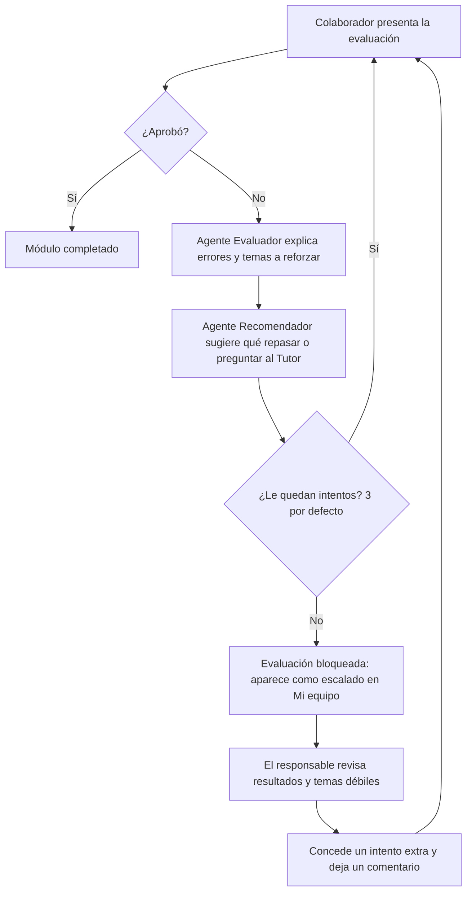

# PRD — Plataforma de Onboarding Interactivo Guiado por Agentes Inteligentes

**Empresa:** PluriOne S.A. de C.V. (Develop Talent & Technology)
**Documento:** Product Requirements Document
**Versión:** 2.1 · 29 de octubre de 2026 (alineada con lo construido)
**Documentos relacionados:** [`README.md`](README.md) (cómo se instala y configura) · [`docs/MVP.md`](docs/MVP.md) (qué entra en la v1 y dónde está en el código) · [`backend/app/models.py`](backend/app/models.py) (modelo de datos)

---

## 1. Resumen ejecutivo

PluriOne necesita automatizar y personalizar la incorporación de nuevos colaboradores. Hoy ese proceso es manual: instrucciones dispersas por correo, checklists en hojas de cálculo y un seguimiento que depende de que alguien de RH se acuerde de preguntar.

La plataforma resuelve esto con **5 agentes de IA** que guían al colaborador de punta a punta (dudas, capacitación, evaluaciones y siguientes pasos), mientras RH y los supervisores mantienen visibilidad y control sin operar cada paso a mano.

**Principio de producto:** el sistema intenta resolver un problema por sí mismo antes de escalarlo a una persona. La intervención humana es el último recurso; esto se refleja en el manejo de evaluaciones reprobadas (sección 6.4).

---

## 2. Problema y justificación

| | |
|---|---|
| **Impacto en la industria** | Digitaliza y estandariza la incorporación del talento, que hoy es un proceso ad hoc que varía según quién lo ejecute. |
| **Valor para la empresa** | Consolida una solución HRTech propia, enfocada al ciclo de vida del colaborador, en vez de depender de procesos manuales o herramientas genéricas. |
| **Costo de no resolverlo** | Onboarding lento y desigual, RH saturada respondiendo las mismas preguntas y ningún dato consolidado sobre dónde se atoran los colaboradores nuevos. |

---

## 3. Usuarios y roles

El sistema arranca con tres roles: `colaborador`, `supervisor` y `rh`. **No están escritos como reglas fijas en el código:** son datos en las tablas `roles`, `permisos` y `rol_permisos`. Cada ruta del backend pide un permiso (por ejemplo `documentos.revisar`) con `requiere_permiso(...)` (`backend/app/seguridad.py`), y qué rol tiene cada permiso se consulta en la base de datos. Si la empresa reorganiza estas funciones, se ajustan los permisos con datos, sin cambiar código. **Nadie se registra solo:** RH da de alta a todas las personas.

### 3.1 Colaborador nuevo
- Iniciar sesión con correo y contraseña (la primera vez, con una contraseña temporal que debe cambiar) o con su cuenta de Microsoft (Entra ID).
- Subir, cambiar o quitar su foto de perfil.
- Ver su ruta de onboarding: tareas por etapa (Día 1, Semana 1, Mes 1), documentos y módulos, con su porcentaje de avance y anillos de progreso por etapa.
- Subir los documentos requeridos (PDF o imagen, arrastrando el archivo) y ver si fueron validados o rechazados, con el motivo.
- Leer los módulos de capacitación en orden; cada módulo se desbloquea al terminar el anterior.
- Presentar la evaluación de cada módulo, con un número limitado de intentos (3 por defecto), y recibir la retroalimentación del Agente Evaluador.
- Recibir recomendaciones del Agente Recomendador en su inicio.
- Conversar con el Tutor IA (Tutor de Onboarding y Agente de Conocimiento General).

### 3.2 Recursos Humanos
- Dar de alta, editar, dar de baja y reactivar a colaboradores, supervisores y otras cuentas de RH; generar una nueva contraseña temporal; corregir nombres.
- Eliminar definitivamente a una persona con todo su registro (sección 6.7).
- Asignar a cada colaborador su programa de onboarding y su supervisor responsable.
- Crear y editar programas, módulos (con su contenido por secciones), preguntas de evaluación, calificación mínima e intentos permitidos.
- Revisar documentos con vista previa, y validarlos o rechazarlos con motivo.
- Administrar la base de conocimiento que consulta el Tutor.
- Ver el panel con el avance de todos los procesos, filtrado por área.
- Consultar al Asistente de RH sobre el estado del personal.

### 3.3 Supervisor (responsable)
Da seguimiento únicamente a los colaboradores que RH le asignó (`usuarios.supervisor_id`); **no administra la plataforma.**
- Ver a su equipo, con avance, estado y quién agotó sus intentos de evaluación (sin abrir el detalle).
- Ver el detalle de cada persona: módulos, evaluaciones con intentos, documentos y comentarios.
- Dejar comentarios y acciones de seguimiento (solicitud, apoyo, seguimiento realizado).
- Conceder un intento extra en una evaluación cuando la persona agotó los suyos.
- Recibir una sugerencia del Agente Recomendador sobre cómo apoyar a cada persona.

> Se evaluó y descartó que el supervisor también subiera material de capacitación: dos roles editando el mismo módulo sin control de versiones era un riesgo real de conflicto. Esa gestión quedó únicamente en RH.

---

## 4. Objetivos y métricas de éxito

| Objetivo | Métrica | Dato que ya registra la plataforma |
|---|---|---|
| Reducir el tiempo de onboarding | Días promedio desde el ingreso hasta completar el proceso | `fecha_ingreso` y `progreso_modulos.completado_en` |
| Reducir la carga operativa de RH | Preguntas resueltas por el Tutor sin intervención de RH | `consultas_tutor` (con intención y tema) |
| Detectar riesgo de reprobación a tiempo | Casos resueltos con la retroalimentación vs. escalados al responsable | `evaluaciones` (intentos) y `progreso_modulos.intentos_extra` |
| Estandarizar la capacitación | % de colaboradores que aprueban cada módulo en el primer intento | `evaluaciones` |

---

## 5. Alcance del MVP

El detalle, con la ubicación de cada función en el código, está en [`docs/MVP.md`](docs/MVP.md). Resumen:

- **Dentro:** alta por RH con contraseña temporal, inicio de sesión (correo y Entra ID), baja y eliminación de personas, foto de perfil, ruta con tareas, documentos con revisión, capacitación secuencial, evaluaciones con límite de intentos y escalamiento al responsable, los 5 agentes de IA, panel de RH, seguimiento del supervisor, avisos en tiempo real, Docker y GitHub Actions.
- **Fuera (Fase 2):** ver la sección 12.

---

## 6. Requisitos funcionales por épica

### 6.1 Autenticación y alta de colaborador
- RH da de alta a la persona; el sistema genera una contraseña temporal que RH ve en pantalla y que se envía por correo. En el primer inicio de sesión se pide crear una contraseña propia.
- "¿Olvidaste tu contraseña?" envía un enlace de un solo uso que vence en 30 minutos.
- Una cuenta dada de baja siempre ve el aviso de baja, aunque escriba mal la contraseña.
- Inicio de sesión con Microsoft Entra ID (MSAL), solo para personas ya dadas de alta con ese correo. Microsoft muestra "Elegir una cuenta" y vuelve a pedir la contraseña en cada inicio de sesión, aunque recuerde la cuenta. Si el navegador bloquea la ventana emergente, el inicio de sesión continúa en la misma pestaña. Al salir se borra lo que MSAL guardó en el navegador. Configurado y probado con un directorio de Entra propio; en producción, TI de PluriOne registra la aplicación en el directorio de la empresa (ver README).
- Validaciones: correo sin espacios, nombre solo con letras y con forma de nombre real.
- Foto de perfil: cada persona sube la suya desde el avatar del encabezado (JPG o PNG, máximo 2 MB; el backend revisa el contenido real del archivo). Se ve en el encabezado, en Personal de RH, en Mi equipo y en la tarjeta del supervisor del colaborador. Solo la ven personas con sesión iniciada.

### 6.2 Documentos
- El colaborador sube cada documento requerido (PDF, JPG o PNG, hasta 5 MB).
- RH lo revisa con vista previa y lo valida o rechaza con motivo; el colaborador puede volver a subirlo.
- Cada documento pertenece a un tipo (`tipos_documento`); al volver a subirlo se reemplaza el anterior.

### 6.3 Capacitación
- Módulos por programa, con contenido en secciones, gestionados por RH.
- Desbloqueo secuencial: el primer módulo sin completar queda "en curso" y los siguientes, bloqueados.
- Un módulo con evaluación solo se completa al aprobarla; uno sin evaluación, al leer todas sus secciones.
- Evaluación de opción múltiple con calificación mínima e intentos permitidos configurables por módulo.

### 6.4 Manejo de reprobación (intentos y escalamiento)

Reglas implementadas:
- **Intentos permitidos** = `modulos.intentos_maximos` (3 por defecto, RH lo cambia de 1 a 10) + `progreso_modulos.intentos_extra`.
- Con los intentos agotados, el backend rechaza un nuevo intento (403) y la pantalla de Evaluaciones explica que el responsable o RH pueden conceder otro.
- **El caso se escala al supervisor responsable:** en "Mi equipo" la persona aparece primero, con la etiqueta "Agotó intentos · módulo" y un aviso con cuántas personas requieren intervención.
- Al conceder el intento extra se registra un comentario de seguimiento que el colaborador ve en su inicio. RH también puede concederlo (misma ruta del backend).
- El responsable tiene el contexto completo en el detalle: calificaciones, intentos usados y la sugerencia del Agente Recomendador.

### 6.5 Preguntas y soporte (Tutor IA)
- **Tutor de Onboarding:** responde sobre el proceso, la plataforma y las políticas de PluriOne usando RAG (búsqueda BM25) sobre la base de conocimiento que administra RH, y cita las fuentes.
- **Agente de Conocimiento General:** responde preguntas generales o definiciones sin consultar documentos internos.
- Un orquestador decide cuál de los dos responde cada pregunta. El chat es en tiempo real (WebSocket) y guarda el historial.
- El chat abre con un saludo corto con el nombre de pila: "¡Hola, Ana! ¿En qué puedo ayudarte?". Cada respuesta muestra qué agente contestó.

### 6.6 Seguimiento y panel de RH / supervisor
- Panel de RH con el avance de todos los procesos, alertas de retraso y temas más consultados al Tutor.
- Vista del supervisor filtrada a su equipo, con el escalamiento de la sección 6.4.
- Comentarios y acciones de seguimiento del supervisor, visibles para el colaborador.
- Asistente de RH para consultar el estado del personal en lenguaje natural.

### 6.7 Roles y permisos
- Catálogo de roles y permisos configurable por datos (tablas `roles`, `permisos` y `rol_permisos`, cargadas por la migración `0003`). Los permisos que revisa el código están en `backend/app/permisos.py`.
- Dar o quitar un permiso a un rol es agregar o borrar una fila en `rol_permisos`; el alta de personal solo acepta roles del catálogo. `GET /api/rh/roles` muestra el catálogo vigente.
- Además del permiso, el supervisor solo accede a los colaboradores que tiene asignados.
- Las sesiones se guardan en Redis y se cierran al dar de baja a la persona o al cambiar su contraseña.
- **Baja vs. eliminación:** la baja conserva todo el historial y se puede revertir. Eliminar (bote de basura en Personal, con confirmación) borra a la persona y su registro: avance, evaluaciones, documentos con sus archivos, foto, comentarios sobre ella y consultas al Tutor. Los comentarios que escribió sobre otros colaboradores **se conservan** como "Usuario eliminado" (migración `0004`), y si era responsable, sus colaboradores quedan sin asignar. Nadie puede eliminarse a sí mismo.

---

## 7. Arquitectura (referencia)

| Capa | Tecnología |
|---|---|
| Frontend | React.js (Vite) |
| Backend | Python + FastAPI (REST y WebSocket) |
| Agentes | LangGraph + LangChain sobre Azure OpenAI Service; Google Gemini como alternativa |
| Datos | PostgreSQL + Redis |
| Autenticación | Correo y contraseña; Microsoft Entra ID (SSO) |
| Infraestructura | Docker + GitHub Actions |

**Agentes de IA (5):**

| Agente | Qué hace | Código |
|---|---|---|
| Agente de Conocimiento General | Preguntas generales y definiciones, sin documentos internos | `backend/app/agente.py` |
| Tutor de Onboarding | Guía del proceso, la plataforma y las políticas (RAG) | `backend/app/agente.py`, `backend/app/rag.py` |
| Agente Evaluador | Explica los errores de cada evaluación y qué reforzar | `backend/app/evaluador.py` |
| Agente Recomendador | Siguientes pasos para el colaborador y sugerencias para el supervisor | `backend/app/recomendador.py` |
| Asistente de RH | Consultas sobre el estado del personal con datos reales | `backend/app/asistente_rh.py` |

Patrón: un orquestador (grafo de LangGraph) enruta cada pregunta del chat al agente adecuado; el Evaluador, el Recomendador y el Asistente de RH se llaman desde su propia pantalla. Los nombres que ve el usuario se cambian en `backend/app/nombres_agentes.py`.

---

## 8. Requisitos no funcionales

- **Seguridad:** permisos configurables por rol en cada ruta, contraseñas con bcrypt, enlaces de un solo uso con vencimiento, límite de peticiones en inicio de sesión, recuperación de contraseña y chats, y documentos servidos solo a usuarios autenticados con permiso.
- **Cumplimiento:** marco legal de protección de datos aplicable (LFPDPPP en México).
- **Disponibilidad:** el chat con agentes y la carga de documentos son las rutas críticas; el panel tolera mayor latencia.
- **Costos de IA:** límite de mensajes por minuto en el Tutor y el Asistente de RH, historial acotado y retroalimentación y recomendaciones guardadas para no generarlas dos veces.
- **Calidad:** pruebas automáticas (pytest) con un modelo de IA falso, que corren en GitHub Actions en cada cambio.

---

## 9. Experiencia de usuario

Interfaz propia (sin plantillas) con colores pastel, modo claro y oscuro, navegación lateral por rol, anillos de progreso por etapa, avisos de validación junto a cada campo y vistas adaptadas a celular.

---

## 10. Supuestos y dependencias

- **Microsoft Entra ID** funciona: se configuró y probó con un directorio de Entra propio (gratuito). Para producción, TI de PluriOne registra la aplicación en el directorio de la empresa y cambia `ENTRA_TENANT_ID` y `ENTRA_CLIENT_ID`.
- **Azure OpenAI** se activa con la suscripción de Azure de PluriOne. Durante el desarrollo no fue posible obtenerla (Azure for Students rechazó la cuenta), por lo que la IA funciona con Google Gemini mediante su API compatible con OpenAI.
- RH define los programas de onboarding iniciales.
- No hay API confirmada de los sistemas de RH: el MVP usa alta manual.
- Los documentos de `backend/conocimiento/` son de ejemplo; la información oficial de RH los reemplaza o se carga desde la pantalla "Base del Tutor IA".

---

## 11. Riesgos

| Riesgo | Impacto | Mitigación en el MVP |
|---|---|---|
| Sin suscripción de Azure durante el desarrollo | No se puede demostrar Azure OpenAI | Capa de IA desacoplada con LangChain (Gemini como alternativa); se activa con tres variables del `.env`, sin cambiar código |
| Adopción baja de los chatbots | El onboarding se abandona a medio camino | Ruta visual con tareas como respaldo; el chat es un apoyo, no el único camino |
| Alucinaciones en respuestas de política interna | Información incorrecta a un colaborador nuevo | RAG con fuente controlada y citas; el agente general no responde sobre políticas internas |
| Límite diario del plan gratuito de Gemini | La IA deja de responder ese día | Mensaje claro de "IA no disponible"; la plataforma sigue funcionando sin IA |
| Sin API de HRIS | El alta manual duplica trabajo de RH | Aceptado como límite conocido del MVP |

---

## 12. Fuera de alcance (Fase 2)

- Intento de recuperación automático tras una conversación dirigida con el Tutor.
- Historial de versiones de documentos (hoy se reemplaza al volver a subir).
- Material de capacitación multiarchivo (diapositivas, PDF, imágenes dentro de los módulos).
- Pantalla para editar roles y permisos desde la interfaz (hoy se editan en la base de datos) y bitácora de auditoría.
- Alertas con severidad y notificaciones persistidas (leído / no leído).
- Sincronización con sistemas de RH (HRIS).
- Botón en la interfaz de RH para conceder intentos extra (hoy lo hace el responsable; RH puede hacerlo vía API).

---

## 13. Cronograma de alto nivel

1. Detección de necesidades → este PRD y el análisis del proceso actual
2. Propuesta → validación del alcance del MVP con el asesor
3. Arquitectura → sección 7 y [`README.md`](README.md)
4. Planificación → backlog por épica (sección 6)
5. Desarrollo → backend, frontend, agentes e integraciones
6. Pruebas → pruebas automáticas y revisión funcional
7. Documentación → README, PRD y [`docs/MVP.md`](docs/MVP.md)
8. Mantenimiento → esquema de soporte
9. Capacitación → a administradores y personal de RH
10. Cierre → evaluación posterior a la implementación
